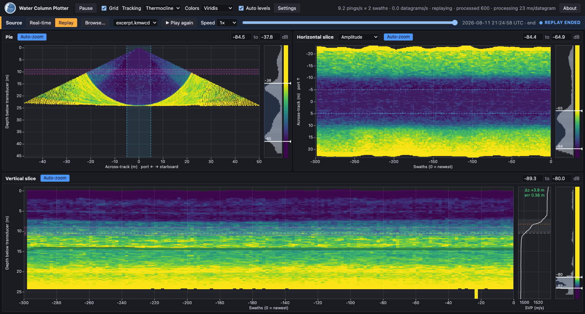

# Water Column Plotter

Real-time display of multibeam sonar water column data, in a web browser.

Water Column Plotter receives water column datagrams from a multibeam echosounder as they're recorded, or replays a
recorded file, and shows them in three linked views:

- **Pie**: the latest swath's fan of beams, as a cross-section below the transducer.
- **Vertical slice**: a curtain beneath the vessel. Each column averages the water column across a narrow band
  either side of nadir, over a few swaths, so it builds up a profile of the water column along the track.
- **Horizontal slice**: one depth band (a slice depth and thickness) across the whole swath, over time, which shows
  targets and layers to either side of the track. It can show amplitude, or the amplitude-weighted depth of the
  signal within the band, colored or shaded as a surface.

It can also:

- **Suppress sidelobe interference**, which otherwise floods the water column beyond the range of the nearest seafloor:
  by subtracting medians per transmit sector, range and beam medians, or each beam's mean over recent pings.
- **Track scattering layers or the thermocline** in the vertical slice, and alert when the sound speed profile in use
  no longer matches the thermocline the sonar sees: a sign that a new cast is needed.
- **Replay recorded files** (`.kmall` / `.kmwcd`), with play/pause, speed (0.5x to 10x, or as fast as possible) and
  seeking.
- **Be viewed from several computers at once.** One copy runs alongside the sonar and any browser on the network can
  view it.

**Only Kongsberg water column data is supported for now**: the `#MWC` water column datagrams of Kongsberg's
`.kmall` format (EM 2040, EM 712, EM 304 and other systems run by SIS or K-Controller), received over UDP or read from
`.kmall` / `.kmwcd` files. The sound speed profile (`#SVP`) and installation (`#IIP`) datagrams are used too.



## Installation

You need Python 3.10 or later and git. The steps put Water Column Plotter and the Python packages it uses in a folder
of their own (`.venv`, inside the downloaded code), so they don't affect anything else on the computer.

### Linux (Ubuntu 22.04 and later)

```bash
sudo apt update
sudo apt install -y git python3-venv python3-pip

git clone https://github.com/valschmidt/WaterColumnPlotter.git ~/WaterColumnPlotter
cd ~/WaterColumnPlotter
python3 -m venv .venv
.venv/bin/python -m pip install --upgrade pip
.venv/bin/python -m pip install -e .

# Make the wcp command available from any directory
mkdir -p ~/.local/bin
ln -s ~/WaterColumnPlotter/.venv/bin/wcp ~/.local/bin/
```

Log out and back in once (or run `source ~/.profile`) so `~/.local/bin` is on your PATH. After that, `wcp` starts the
plotter from any directory.

### macOS

Install Python 3.10 or later from [python.org](https://www.python.org/downloads/) or with Homebrew
(`brew install python`). git comes with Apple's command line tools (`xcode-select --install`). Then:

```bash
git clone https://github.com/valschmidt/WaterColumnPlotter.git ~/WaterColumnPlotter
cd ~/WaterColumnPlotter
python3 -m venv .venv
.venv/bin/python -m pip install --upgrade pip
.venv/bin/python -m pip install -e .

# Make the wcp command available from any directory
mkdir -p ~/.local/bin
ln -s ~/WaterColumnPlotter/.venv/bin/wcp ~/.local/bin/
echo 'export PATH="$HOME/.local/bin:$PATH"' >> ~/.zprofile
```

Open a new terminal window, and `wcp` starts the plotter.

### Windows

Install Python 3.10 or later from [python.org](https://www.python.org/downloads/) (check "Add python.exe to PATH" in
the installer) and [Git for Windows](https://git-scm.com/download/win). Then, in PowerShell:

```powershell
git clone https://github.com/valschmidt/WaterColumnPlotter.git $HOME\WaterColumnPlotter
cd $HOME\WaterColumnPlotter
py -m venv .venv
.venv\Scripts\python -m pip install --upgrade pip
.venv\Scripts\python -m pip install -e .
```

Start the plotter with `$HOME\WaterColumnPlotter\.venv\Scripts\wcp`.

### Updating

```bash
cd ~/WaterColumnPlotter
git pull
.venv/bin/python -m pip install -e .     # Windows: .venv\Scripts\python -m pip install -e .
```

The last step is needed only when the packages Water Column Plotter uses change, but it's quick and harmless when
they haven't.

## Running

```bash
wcp
```

starts the plotter and opens it in your web browser at <http://localhost:8000/>. Stop it with Ctrl-C in the terminal.

**Real-time data.** By default the plotter listens for datagrams on UDP port 6020. In SIS or K-Controller, have the
sonar send its water column datagrams to this computer's address and that port. To change the address or port,
use **Configure…** in the page's Source bar, or start the plotter with them:

```bash
wcp --udp-port 6020
wcp --multicast 225.255.255.255 --udp-ip 192.168.1.20   # join a multicast group on this interface
```

**Replaying a recording.** Click **Replay** in the Source bar and choose a `.kmall` or `.kmwcd` file in the Open dialog,
or name one when starting:

```bash
wcp --replay ~/data/0001_20260811_212442.kmwcd
```

**Viewing from other computers.** The page is served to this computer only, unless you start the plotter with
`--http-host 0.0.0.0`; then browse to `http://<plotter's address>:8000/` from any computer on the network. Everyone
viewing shares the same settings and data source.

| Option | Default | |
|---|---|---|
| `--udp-ip ADDRESS` | `0.0.0.0` (all) | Address to receive datagrams on (with multicast: this computer's interface address). |
| `--udp-port PORT` | `6020` | UDP port to receive datagrams on. |
| `--multicast GROUP` | none | Multicast group to join. |
| `--http-host ADDRESS` | `127.0.0.1` | Address to serve the page on; `0.0.0.0` allows viewing from other computers. |
| `--http-port PORT` | `8000` | Port to serve the page on. |
| `--update-interval SECONDS` | `1.0` | Time between display updates. |
| `--no-browser` | | Don't open a browser window. |
| `--replay FILE` | | Replay this recorded file at start-up. |
| `--data-dir DIR` | the current directory | Where browsing for recordings to replay starts. |

`wcp --help` lists them too. The display's own settings (cell size, slice depth, sidelobe suppression, tracking and
so on) are in the page's **Settings** panel.

## The original Qt version

This repository also holds the original desktop version of Water Column Plotter, written with PyQt5, which the browser
version is replacing. To install it as well, use `pip install -e ".[gui]"` in place of `pip install -e .`; it runs as
`water_column_plotter`.

## Documentation

- [Browser version design](docs/browser-design.md): how the plotter is put together.
- [Experiments](docs/experiments.md): features being tried out, with notes and measurements.

## Acknowledgements

- **Lynette Davis** wrote the original Water Column Plotter (2021–2022), from which this version grew.
- **Jose Cordero Ros**: the thermocline tracking and cast alert follow the method of his MS thesis,
  [*Improved Sound Speed Control Through Remotely Detecting Strong Changes in the Thermocline*](https://scholars.unh.edu/cgi/viewcontent.cgi?article=2245&context=thesis)
  (University of New Hampshire, 2018).
- **Roland Arsenault**: the scattering layer tracking follows the approach of his
  [watercolumn_layer_tracker](https://github.com/rolker/watercolumn_layer_tracker).

Kongsberg datagrams are read with [pykmall](https://pypi.org/project/pykmall/). Val Schmidt maintains Water Column
Plotter and wrote the browser version, with Claude (Anthropic) as an AI coding assistant.

## Copyright and license

Copyright © 2021–2026 University of New Hampshire, Center for Coastal and Ocean Mapping / Joint Hydrographic Center.
All rights reserved.

Water Column Plotter is distributed under the BSD 3-Clause License; see [LICENSE](LICENSE). Redistributions must
keep the copyright notice.
